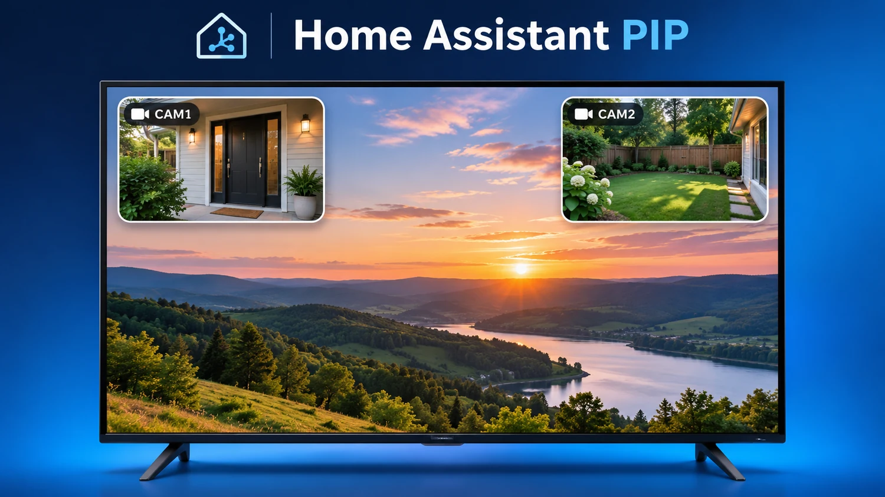

[](https://github.com/tixelcat/ha-lg-webos-pip/releases/latest)

# Home Assistant PIP for LG webOS TVs

**Version 1.0.6 — dual-camera overlay, configured on the TV.** Show one or two Home Assistant camera streams in separate corners above the existing LG TV picture. Camera selection, size, position, enable/disable state and auto-close time are configured directly in the TV app; Home Assistant can trigger the saved layout with one simple action.



*Concept illustration. Select each camera, corner, size (10%-50%), and On/Off state in the TV app.*

**Downloads:** [GitHub Releases](https://github.com/tixelcat/ha-lg-webos-pip/releases) → select **1.0.6** → Assets → `io.github.tixelcat.lgwebospip_1.0.6_all.ipk`. For installation, configuration and troubleshooting, see **[INSTALLATION.md](INSTALLATION.md)**.

> **App ID and filename are intentionally different.** The downloadable IPK is branded `tixelcat`, but the *internal* webOS ID is still **`io.github.isdaddy.lgwebospip`**. Use the internal ID in `webostv.command` and `luna-send`. This preserves existing installations and Home Assistant automations.

## What's new in 1.0.6

- **Two independent camera slots:** select Camera 1 and Camera 2 from the camera list retrieved from Home Assistant. A single HA connection and existing **Test connection** button are reused.
- **Separate On/Off switches:** turn either camera off with one click, or turn both off. The source, corner and size selections remain saved. If both are Off, `show_saved` exits without displaying a PIP.
- **Four selectable corners:** top left, top right, bottom left, bottom right. When two cameras are enabled and selected, the same corner cannot be assigned to both; switching one off frees its corner.
- **Separate sizes:** **10%, 20%, 30%, 40% or 50% of TV width** for each camera. Equal sizes give **equal-width, equal-height 16:9 windows** in dual-camera mode; differing camera aspect ratios are fitted without stretching.
- **Widescreen menu:** Home Assistant configuration on top, Camera 1 on the left, Camera 2 on the right, and **Save / Preview / Exit** at the bottom.
- **Saved-layout launch:** `show_saved: true` displays the enabled cameras using the TV's saved settings, including **Close after**. No `camera`, `position`, `size`, or `timeout` is needed in this action.
- **Optional title:** a `title` passed with `show_saved` is shown on the primary active overlay (or Camera 2 if Camera 1 is disabled).
- **Backward compatibility:** an existing automation with an explicit `camera:` still opens that single camera; legacy commands do not depend on the new On/Off switches.

## Quick start

1. Install **Home Assistant PIP 1.0.6** on your LG TV using the IPK from the release (rooted/Homebrew SSH or Developer Mode — see [INSTALLATION.md](INSTALLATION.md)).
2. Make sure the TV is paired with Home Assistant's **built-in LG webOS TV integration**.
3. Open **Home Assistant PIP** in the TV app list. Enter the Home Assistant URL and a long-lived access token; select **Test connection** to load available cameras.
4. Choose a camera in either column, set its corner and size, set **Show camera** to On or Off, choose the global **Stream** mode and **Close after** time; press **Save**. **Preview** shows the current choices before or after saving.
5. In Home Assistant → **Developer tools → Actions**, launch the saved TV layout with the action below.

### Recommended: launch the cameras saved on the TV

```yaml
action: webostv.command
data:
  entity_id: media_player.your_lg_tv
  command: system.launcher/launch
  payload:
    id: io.github.isdaddy.lgwebospip
    params:
      show_saved: true
```

This exact form was **confirmed working on a real LG TV** with 1.0.6. Replace `media_player.your_lg_tv` with your actual entity ID. The TV decides **which cameras**, **where**, **how large** and **for how long**; `params.show_saved: true` is enough. Do not add a size or timeout just to reproduce the saved TV configuration.

### Doorbell example (optional title)

```yaml
alias: "LG TV - doorbell live cameras"
description: "Show the saved TV camera layout when someone rings"
triggers:
  - trigger: state
    entity_id: binary_sensor.front_doorbell
    from: "off"
    to: "on"
conditions: []
actions:
  - action: webostv.command
    data:
      entity_id: media_player.your_lg_tv
      command: system.launcher/launch
      payload:
        id: io.github.isdaddy.lgwebospip
        params:
          show_saved: true
          title: "🔔 Someone is at the door!"
mode: restart
```

Replace the example doorbell and TV entity IDs. The sensor must actually change from `off` to `on`. The `title` is optional; it does not control the cameras' positions or sizes.

### Backward-compatible: show one specified camera

Existing 1.0.5-style automations remain supported:

```yaml
action: webostv.command
data:
  entity_id: media_player.your_lg_tv
  command: system.launcher/launch
  payload:
    id: io.github.isdaddy.lgwebospip
    params:
      camera: camera.front_door
      timeout: 10
```

An explicit `camera:` **takes priority** over the TV's saved camera choices and shows a single camera. That launch is independent of both saved-camera On/Off switches. When using `show_saved`, omit `timeout` if the app's **Close after** setting should apply; `timeout` can still override it deliberately.

## What happens when cameras are switched off?

| Camera 1 | Camera 2 | `show_saved: true` result |
| --- | --- | --- |
| On | On | Two overlays in different corners (when both sources are selected) |
| On | Off | Camera 1 only |
| Off | On | Camera 2 only |
| Off | Off | No camera overlay; the TV app closes |

A camera with **no selected source** is not displayed, even when its switch is On. Switching a camera off does not erase its camera selection, position or size.

## Components and compatibility

| Component | Role |
| --- | --- |
| [`webos-app/`](webos-app/) | webOS TV overlay app, camera settings and playback |
| Built-in LG webOS TV integration | Provides the recommended `webostv.command` action |
| [`custom_components/lg_webos_pip/`](custom_components/lg_webos_pip/) | Optional custom HA integration retained for compatibility; not required for the recommended saved-layout action |

**Tested:** both-camera playback, saved settings, one/both camera switches, positions, 10% increments, equal-size dual windows, old single-camera launch, the optional title, and the saved-camera Home Assistant action on one rooted LG webOS TV. The existing overlay behavior over live TV/IPTV/YouTube and remote-control handling was preserved during user testing. Compatibility with other models, firmware and protected-content apps is not guaranteed. MJPEG is recommended for overlays over ongoing TV playback; HLS/WebRTC can have device-specific limitations. Rooted Homebrew screensaver wake is best effort and requires compatible services; root is not required for basic PIP.

**Security:** do not commit or publish Home Assistant access tokens, `.env` files, TV storage backups, personal IP addresses or an IPK containing a baked-in token. For a reproducible public build, build without `HA_URL`, `HA_TOKEN` or `HA_CAMERA` environment variables. Keep any camera-access token private.

## Upgrading and development

- **1.0.5 → 1.0.6:** install over the existing app, retaining the legacy internal app ID. Reopen the TV settings, select Camera 2 if desired, set each switch and corner, and press **Save**. Previously stored connection and camera 1 settings remain compatible; camera sizes available in the menu are now rounded to 10% steps.
- **Build locally:** in `webos-app`, run `npm ci`, `npm run build`, then `ares-package build -o dist`. Do not package the raw `app/` directory without building first. See [INSTALLATION.md](INSTALLATION.md) for complete instructions.
- **Release numbering:** version numbers are written **without a leading `v`**: `1.0.6`, matching the project's naming convention. The installer filename remains `io.github.tixelcat.lgwebospip_1.0.6_all.ipk`.
- **Changes:** see [MODIFICATIONS.md](MODIFICATIONS.md) and [release notes](RELEASE_NOTES_1.0.6.md).

## Credits / license

Enhanced community fork maintained by [tixelcat](https://github.com/tixelcat), based on the original [ISDaddy/ha-lg-webos-pip](https://github.com/ISDaddy/ha-lg-webos-pip) project by [ISDaddy](https://github.com/ISDaddy). **MIT License**; preserve the upstream copyright and notices. Not affiliated with LG or Home Assistant.
